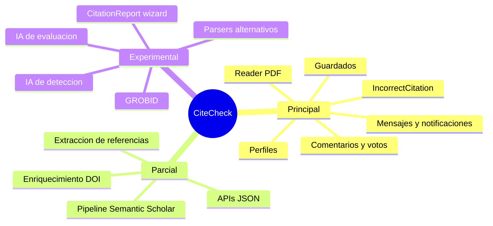

# Estado del Sistema

Estado revisado: 2026-05-23.

Este documento resume la madurez técnica de los módulos principales. Úsalo para decidir qué piezas son flujo principal, cuáles están en beta y cuáles son experimentos aislados.

## Mapa de Módulos

## Tabla de Madurez

| Módulo | Estado | Archivos principales | Riesgo |
| --- | --- | --- | --- |
| Reportes `IncorrectCitation` | Estable | `models.py`, `page_views.py`, `ajax_views.py` | Cambios de campos requieren migraciones y revisión de plantillas. |
| Perfiles | Estable | `UserProfile`, `user_views.py`, `account_settings.html` | Mezcla datos públicos, privacidad y preferencias de idioma. |
| Comentarios, votos y guardados | Estable | `Comment`, `Vote`, `SavedCitation`, parciales de templates | Debe conservar restricciones de voto único y permisos de edición/borrado. |
| Mensajes y notificaciones | Estable | `Conversation`, `Message`, `Notification`, `signals.py`, `notifications.py` | Requiere consistencia de URLs y destinatarios. |
| Reader React | Estable con deuda | `frontend_reader/`, `reader.html`, `reader_preview.html` | Dependencia de bundle compilado o Vite dev server; DOM de PDF sensible a cambios. |
| API de extracción | Parcial | `views_api.py`, `engines.py`, `references_data.py` | Payload grande y heterogéneo; algunos errores no comparten formato único. |
| Pipeline Semantic Scholar | Parcial | `semantic_citation_pipeline.py`, `semantic_scholar_client.py` | Rate limits, PDFs no open access y latencia de descargas. |
| Enriquecimiento DOI | Parcial | `doi_enrichment_service.py`, `crossref_client.py` | Matching heurístico; debe rechazar falsos positivos. |
| Regresión de referencias | Útil para mantenimiento | `scripts/run_reference_regression.py` | Pesado; produce artefactos en `tmp/reference_regression/`. |
| GROBID | Experimental aislado | `grobid_client.py`, `grobid_parser.py`, comandos `debug_grobid*` | No afecta al flujo principal; requiere servicio externo local o remoto. |
| Parsers alternativos | Experimental aislado | `reference_parsing_experiments/` | AnyStyle y LLM dependen de herramientas/credenciales externas. |
| Módulos IA | Experimental | `ai_citation_detector.py`, `ai_report_evaluator.py` | Requieren claves externas; no son parte del flujo principal. |
| `CitationReport` wizard | Legacy/inactivo | `CitationReport`, `views_reports.py`, `report_wizard.html` | No usar como base para nuevas funcionalidades sin revalidarlo. |

## Deuda Técnica Principal

1. **Extracciones síncronas largas.** Analizar PDFs en peticiones HTTP puede provocar timeouts. Celery/RQ sería el siguiente paso natural.
2. **Rate limiting.** Semantic Scholar y Crossref necesitan manejo más explícito de cuotas, reintentos y caché persistente.
3. **Validación de PDF contra DOI.** El sistema resuelve metadatos y PDFs, pero no garantiza siempre que el archivo subido corresponda al DOI indicado.
4. **Formato de errores.** Algunas APIs devuelven `{"ok": false, ...}` y otras solo `{"error": ...}`.
5. **Cobertura focalizada.** Hay tests de clientes y baseline de referencias, pero los servicios de extracción siguen siendo la zona de más riesgo.
6. **Artefactos históricos.** `tmp/` contiene resultados útiles para comparación, pero no debe confundirse con documentación viva.

## Prioridades Recomendadas

- Mantener `IncorrectCitation` como flujo principal y evitar extender `CitationReport` sin una decisión explícita.
- Estandarizar respuestas JSON de error antes de exponer endpoints a consumidores externos.
- Añadir caché y límites de concurrencia al pipeline semántico.
- Usar `scripts/run_reference_regression.py` antes y después de tocar `references_data.py`, `reader_data.py`, `engines.py` o `views_api.py`.
- Mantener GROBID y parsers alternativos como experimentos hasta que exista una comparación reproducible que justifique integrarlos.
