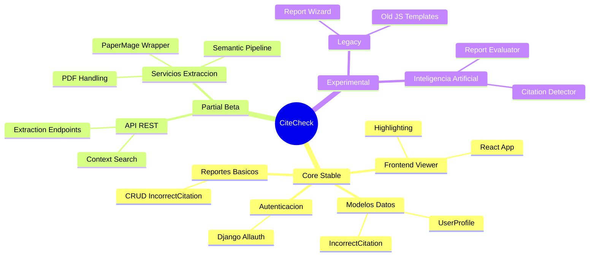

# Estado del Sistema CiteCheck

Este documento detalla el estado actual de madurez de los diferentes módulos del proyecto. Se utiliza para identificar rápidamente qué partes son críticas/estables y cuáles están en fase de desarrollo o experimentación.

## Mapa Mental del Sistema

## Resumen de Módulos

| Módulo / Funcionalidad | Estado | Descripción | Riesgos Principales |
| :--- | :--- | :--- | :--- |
| **Modelos de Datos** | ✅ **Estable** | Esquema de BD (SQLite/Postgres) definido en `models.py`. | Cambios en `IncorrectCitation` pueden requerir migraciones complejas. |
| **Autenticación** | ✅ **Estable** | `django-allauth` con Google y ORCID. No tocar. | Dependencia de claves de API externas (Google/ORCID). |
| **API REST (Core)** | ⚠️ **Parcial** | Endpoints en `views_api.py`. Funcional pero mezcla lógica legacy con nueva. | Falta de validación estricta de payloads en algunos endpoints. |
| **Extracción de Citas** | ⚠️ **Parcial** | Uso de `papermage` y `papercraft`. Funciona pero es lento y pesado. | Requiere instalación compleja de dependencias (PyTorch, Java). Falla con PDFs escaneados (sin OCR). |
| **Viewer Frontend (React)** | ✅ **Estable** | Aplicación en `frontend_reader/` con soporte de resaltado. | Dependencia de `@allenai/pdf-components`. Integración con backend vía `reader.html` (legacy wrapper). |
| **Pipeline Semántico** | ⚠️ **Parcial** | Búsqueda inversa de citadores (`semantic_citation_pipeline.py`). | Depende críticamente de la API gratuita de Semantic Scholar (rate limits). |
| **Reportes (Wizard Legacy)** | 🛑 **Inactivo** | Flujo en `report_wizard.html` y modelo `CitationReport`. | Código muerto o desactivado. No usar como referencia de flujo principal. |
| **Reportes (IncorrectCitation)** | ✅ **Estable** | Flujo actual de creación de reportes. | Interfaz básica, sin wizard paso a paso avanzado. |
| **Módulos IA (Experimental)** | 🧪 **Experimental** | `ai_citation_detector.py`. | No integrado en el flujo principal. Solo pruebas de concepto. |

## Deuda Técnica y Faltantes

1.  **Validación de PDFs:** No hay un sistema robusto para validar si un PDF corresponde realmente al DOI indicado.
2.  **Rate Limiting:** No hay manejo explícito de rate limits para Semantic Scholar en el backend (riesgo de bloqueo 429).
3.  **Logs Estructurados:** El sistema de logging (`citations.context`) es bueno pero no cubre todos los módulos críticos.
4.  **Tests Unitarios:** Cobertura baja en los servicios de extracción (`services/`).
5.  **Hardcoded Paths:** Algunas rutas de archivos temporales o configuraciones de PaperMage pueden no ser portables entre entornos.

## Próximos Pasos Recomendados

*   Consolidar el pipeline de extracción para que sea asíncrono (Celery/RQ) debido a la latencia de descarga/análisis de PDFs.
*   Migrar completamente la lógica de "Report Wizard" al nuevo flujo o eliminar el código muerto.
*   Implementar caché para las respuestas de Semantic Scholar.
