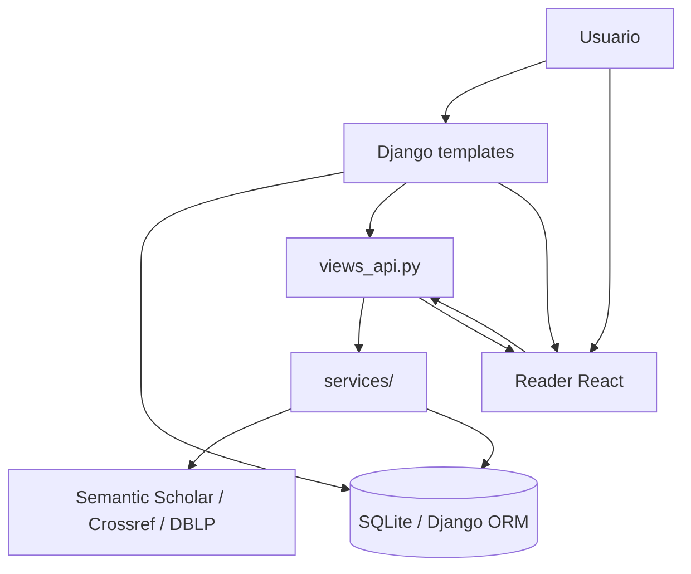

# Flujo de Datos End-to-End

Este documento conecta los flujos principales: creación de reportes, reader PDF, extracción de referencias y búsqueda de citadores.

## Vista Global



## Flujo 1: Reporte Manual

1. El usuario crea o envía un reporte desde la UI.
2. El formulario usa `IncorrectCitationForm`.
3. El backend guarda `doi_original`, `doi_incorrect`, `incorrect_reason`, `citation_type` y `publication_area`.
4. Si hay metadatos disponibles, se guardan en `metadata_original` y `metadata_incorrect`.
5. El detalle del reporte permite comentarios, votos, guardado, extracción de contextos y apertura del reader.

Modelo persistido: `IncorrectCitation`.

## Flujo 2: Reader Preview con PDF Subido

1. El usuario abre `/citations/reader/preview/`.
2. El reader React se monta en `#reader-root`.
3. El usuario sube un PDF.
4. El frontend llama a `POST /citations/api/extract-citations/` con `manuscript`.
5. `views_api.api_extract_citations` ejecuta:
   - `extract_pdf_references()`;
   - `process_manuscript()`;
   - `extract_pdf_data()`;
   - `build_references_data()`;
   - `reconcile_reference_sources()`;
   - `enrich_extraction_with_doi()` si hay DOI.
6. La respuesta devuelve referencias, snippets, capas, estadísticas, datos de artículo y citadores enriquecidos.
7. El reader renderiza referencias y menciones para navegación visual.

## Flujo 3: Reporte Existente al Reader

1. El usuario abre un reporte y pulsa la acción de reader/contexto.
2. Django renderiza `reader.html` con:
   - `data-api-url="/citations/api/reader-data/<id>/"`;
   - `data-pdf-url` si hay PDF resoluble;
   - DOI original y citador.
3. El reader llama a `GET /citations/api/reader-data/<id>/`.
4. El backend resuelve el PDF desde metadatos o Semantic Scholar.
5. Devuelve `pdf_url`, `mentions`, `snippets`, `references` y `stats`.
6. El reader resalta el contexto guardado en `citation_contexts`.

## Flujo 4: Búsqueda de Citadores

1. El usuario introduce un DOI original.
2. El backend consulta Semantic Scholar para encontrar trabajos citadores.
3. Si un citador tiene PDF open access, se descarga temporalmente.
4. Los servicios de extracción buscan patrones de mención al trabajo original.
5. La UI muestra contextos candidatos para revisión humana.
6. El usuario puede transformar el hallazgo en reporte.

Endpoints implicados:

- `GET /citations/api/get-semantic-citations/`
- `GET /citations/api/semantic-citation-analysis/`
- `GET|POST /citations/api/get-citation-context/`

## Objetos de Intercambio

### Contexto de cita

```json
{
  "paragraph": "Texto completo del párrafo...",
  "snippet": "Texto recortado...",
  "page": 5,
  "start": 102,
  "end": 140,
  "pattern": "[12]",
  "section": "body"
}
```

### Datos del reader

```json
{
  "pdf_url": "https://example.org/paper.pdf",
  "snippets": [
    {
      "id": "snippet-1",
      "page": 2,
      "snippet": "...",
      "type": "numeric",
      "confidence": 0.8
    }
  ],
  "references": [
    {
      "index": 1,
      "raw": "[1] Smith ...",
      "doi": "10.1000/example",
      "confidence": 1.0,
      "numbered": true
    }
  ],
  "stats": {
    "pages_total": 12,
    "references_total": 35,
    "dois_total": 18,
    "citation_style": "numeric",
    "max_reference_index": 35
  }
}
```

### Extracción completa

`POST /citations/api/extract-citations/` devuelve un payload más amplio que puede incluir:

- `references`;
- `snippets`;
- `pages`;
- `layers`;
- `references_data`;
- `reference_reconciliation`;
- `reference_debug`;
- `cited_by`;
- `enrichment`;
- `article_info`;
- `stats`.

## Persistencia vs Artefactos

- Persistencia de producto: modelos Django y campos JSON.
- Archivos subidos: `MEDIA_ROOT`.
- Logs: `tfg_project/logs/`.
- Artefactos de debug/regresión: `tmp/reference_debug/`, `tmp/reference_regression/`, `tmp/grobid_debug/`.

Los artefactos de `tmp/` son diagnósticos, no fuente de verdad del producto.
