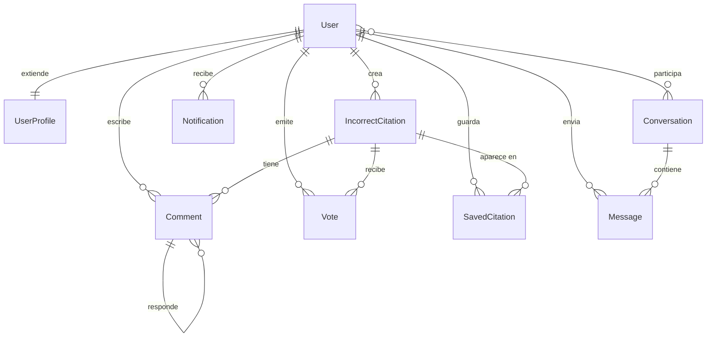

# Modelos y Relaciones

Los modelos viven en `tfg_project/citations/models.py`. El sistema usa `auth.User` de Django y lo extiende mediante `UserProfile`.

## Diagrama E-R

## `IncorrectCitation`

Modelo principal de producción. Representa un reporte de cita incorrecta.

Campos relevantes:

| Campo | Uso |
| --- | --- |
| `author` | Usuario que crea el reporte. Puede ser `NULL` si se elimina el usuario. |
| `doi_original` | DOI del trabajo que fue citado o interpretado incorrectamente. |
| `doi_incorrect` | DOI del trabajo citador donde aparece el problema. |
| `incorrect_reason` | Explicación humana. |
| `metadata_original` / `metadata_incorrect` | JSON de metadatos para renderizar sin depender siempre de APIs externas. |
| `citation_contexts` | JSON con fragmentos/snippets donde aparece la cita. |
| `citation_type` | `not said`, `misinterpretation` o `contextual misattribution`. |
| `publication_area` | Código de área de publicación basado en `AREA_CHOICES`. |
| `created_at` | Fecha de creación. |

Decisión de diseño: los metadatos bibliográficos se guardan en `JSONField` para evitar normalizar entidades externas incompletas o variables (`Article`, `Journal`, `Author`) antes de que el producto lo necesite.

## `UserProfile`

Perfil académico y preferencias del usuario.

Incluye:

- `dblp_url` para importar publicaciones;
- fecha de nacimiento, país e idioma preferido;
- área de investigación, profesión e institución;
- correo de contacto y enlaces sociales;
- preferencias de notificación;
- avatar y bio;
- flags de privacidad: `is_public`, `show_activity`, `show_social_links`.

`UserProfile` se crea mediante señales cuando procede y se usa tanto en ajustes privados como en perfiles públicos.

## Comunidad

### `Comment`

Comentario asociado a `IncorrectCitation`. El campo `parent` permite respuestas anidadas. La construcción del árbol de comentarios se hace en memoria desde las vistas/partials.

### `Vote`

Voto binario sobre un reporte:

- `1`: upvote;
- `-1`: downvote.

`unique_together = ("user", "citation")` impide votos duplicados por usuario y reporte.

### `SavedCitation`

Relación usuario-reporte para guardar reportes. También impide duplicados por `unique_together = ("user", "citation")`.

## Mensajes y Notificaciones

### `Conversation`

Agrupa participantes mediante `ManyToManyField(User)`. La ordenación por defecto es descendente por fecha de creación.

La unicidad de conversaciones entre dos usuarios no está garantizada por la base de datos; debe controlarse desde la lógica de negocio.

### `Message`

Mensaje dentro de una conversación, con `sender`, `content`, `created_at` e `is_read`.

### `Notification`

Alertas para eventos de comunidad o sistema. Tipos actuales:

- `NEW_COMMENT`;
- `NEW_VOTE`;
- `NEW_MESSAGE`;
- `SYSTEM`.

Las notificaciones se construyen desde señales o desde `citations/services/notifications.py`.

## `CitationReport` Legacy

`CitationReport` pertenece a un wizard avanzado de reportes que hoy está inactivo. Conserva campos para PDFs originales/citadores, párrafos y evaluación IA.

No debe usarse como flujo principal sin revisar:

- plantillas `report_wizard.html`;
- `views_reports.py`;
- relación con `IncorrectCitation`;
- persistencia de archivos;
- migraciones y UX.

## Riesgos al Cambiar Modelos

- Cambios en `IncorrectCitation` afectan listado, detalle, reader, modales, reportes guardados, votos y comentarios.
- Cambios en `UserProfile` afectan ajustes, perfil público, DBLP y privacidad.
- Cambios en `Notification` deben coordinarse con dropdown, lista y señales.
- Nuevos campos JSON deben documentar su forma esperada para evitar consumidores frágiles.
