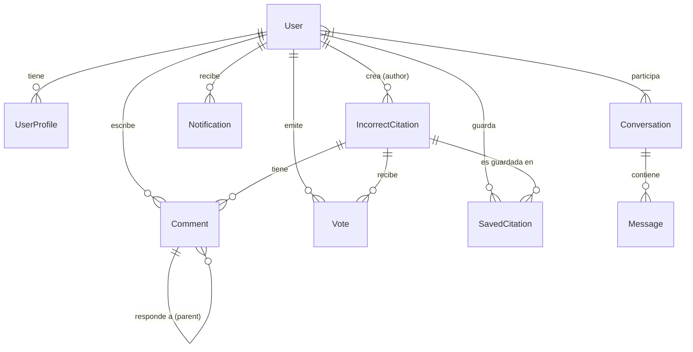

# Modelos y Relaciones

Este documento describe la estructura de datos del backend de CiteCheck (`citations`), las decisiones de diseño tomadas y las relaciones clave entre entidades.

## Diagrama E-R Simplificado (Mermaid)

## Entidades Principales

### 1. `IncorrectCitation` (El Reporte)
Es el modelo central del sistema. Representa una denuncia de una cita incorrecta.

*   **Ubicación:** `citations/models.py`
*   **Campos Clave:**
    *   `doi_original` (Char): DOI del artículo que *debería* haber sido citado o que es la "víctima".
    *   `doi_incorrect` (Char): DOI del artículo que contiene la cita errónea (el "citador").
    *   `citation_type` (Enum): Clasificación del error (`not said`, `misinterpretation`, `contextual misattribution`).
    *   `incorrect_reason` (Text): Explicación humana del error.
    *   `citation_contexts` (JSON): **Crítico.** Almacena los fragmentos de texto (snippets) extraídos del PDF donde aparece la cita.
        *   *Estructura típica:* `[{"text": "...", "page": 1}, ...]`
    *   `metadata_original` / `metadata_incorrect` (JSON): Caché de los metadatos obtenidos de CrossRef/Semantic Scholar para no depender de APIs externas al renderizar.
*   **Decisión de Diseño:** Se optó por guardar metadatos en JSON (`JSONField`) en lugar de crear tablas normalizadas (`Article`, `Journal`, `Author`) para simplificar la ingestión de datos heterogéneos y evitar duplicidad masiva de registros bibliográficos externos.

### 2. `UserProfile`
Extiende el modelo `User` de Django para añadir perfil académico.

*   **Relación:** OneToOne con `auth.User`.
*   **Campos Clave:**
    *   `dblp_url`: Enlace al perfil de DBLP para importar publicaciones.
    *   `research_area`, `institution`, `profession`: Datos demográficos académicos.
    *   `social_link_*`: Enlaces sociales arbitrarios.
    *   Flags de configuración (`notify_comments_on_my_reports`, etc.).

### 3. `Comment` y `Vote` (Interacción)
Permiten la discusión comunitaria sobre la validez de un reporte.

*   **Comment:** Soporta anidamiento simple (un nivel o árbol) mediante el campo `parent`.
*   **Vote:** Voto binario (+1 / -1) para calcular la reputación del reporte. Restricción `unique_together = ("user", "citation")` para evitar votos múltiples.

### 4. `CitationReport` (⚠️ Legacy / Inactivo)
Modelo destinado a un flujo de "Wizard" más complejo que permitía subir PDFs originales y citadores.
*   **Estado:** Actualmente **no se usa** en el flujo de producción principal, que recae en `IncorrectCitation`.
*   **Diferencia:** Este modelo guardaba archivos físicos (`FileField`) para los PDFs, mientras que `IncorrectCitation` tiende a trabajar con URLs o extracciones al vuelo.

## Sistemas de Mensajería y Notificaciones

### `Conversation` y `Message`
Sistema de chat interno.
*   **Lógica:** Una `Conversation` agrupa a N participantes (normalmente 2).
*   **Validación:** Se debe garantizar (por lógica de negocio, no solo base de datos) que solo exista una conversación activa entre dos usuarios específicos.

### `Notification`
Sistema de alertas asíncronas.
*   **Tipos:** `NEW_COMMENT`, `NEW_VOTE`, `NEW_MESSAGE`, `SYSTEM`.
*   **Uso:** Se generan en señales (`signals.py`) o en servicios (`notifications.py`) cuando ocurren eventos.

## Notas para Desarrolladores

*   **Migraciones:** Al modificar `IncorrectCitation`, ten cuidado con los campos `JSONField` si usas SQLite en versiones antiguas (aunque Django moderno lo soporta bien).
*   **Índices:** Actualmente no hay índices complejos definidos explícitamente más allá de las claves foráneas. Si la tabla de reportes crece, será necesario indexar `doi_original` y `doi_incorrect`.
